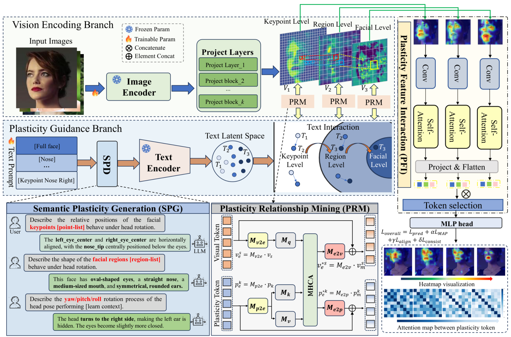

# PlaLLM

## Learning Semantic Plasticity Relationship via Hierarchical Correlational Modeling for Robust Head Pose Estimation

## Abstract

Head pose estimation (HPE) is important for human–robot interaction, yet occlusion, extreme head angles, and complex lighting remain challenging in practical settings. We propose **PlaHPE**, a plasticity relationship learning framework for robust HPE through hierarchical correlational modeling. The framework builds on two insights: facial features are correlated across different levels, and head rotation changes the relative importance of facial regions. A **Semantic Plasticity Generation (SPG)** module uses large language models to describe facial plasticity at multiple granularities. A dual-branch architecture then combines a **Plasticity Relationship Mining (PRM)** module, which aligns textual and visual features to learn high-level semantic knowledge, with a **Plasticity Feature Interaction (PFI)** module, which aggregates multigranularity features for pose prediction. Experiments on AFLW2000 and BIWI demonstrate improved estimation accuracy and robustness. At inference time, prediction uses only the vision encoding branch, without additional textual input.

## Main Contributions

1. **Semantic plasticity relationship learning.** We model facial changes induced by head rotation to identify the relative importance of different facial regions and adaptively focus on informative features across poses and environments.
2. **Hierarchical semantic guidance.** SPG generates descriptions at the **keypoint, region, and facial levels**, while PRM aligns these descriptions with visual features to learn rotation-dependent plasticity relationships.
3. **A dual-branch architecture with multigranularity interaction.** The plasticity guidance branch supports visual representation learning during training, and PFI aggregates key features across scales. Inference relies on the vision encoding branch alone.
4. **Evaluation on standard benchmarks.** Experiments on AFLW2000 and BIWI, with training on 300W-LP, demonstrate the effectiveness of the framework. The ViT-B variant achieves MAEs of **3.45°** and **3.29°**, respectively.

## Method



*Framework overview from Fig. 3 of the paper.*

PlaHPE combines a **vision encoding branch** and a **plasticity guidance branch**:

| Component | Role |
| --- | --- |
| **SPG: Semantic Plasticity Generation** | Generates hierarchical descriptions of facial keypoints, facial regions, and whole-face rotation, and encodes them as semantic embeddings. |
| **PRM: Plasticity Relationship Mining** | Establishes cross-modal interactions between visual and textual features at each level to highlight informative facial regions. |
| **PFI: Plasticity Feature Interaction** | Aggregates multigranularity visual features and selects informative tokens for final head pose prediction. |

During **training**, hierarchical textual knowledge guides the visual branch. During **inference**, only the input image and vision encoding branch are needed; LLM generation and additional textual input are not required.

## Datasets

The paper trains on **300W-LP** and evaluates on **AFLW2000** and **BIWI**. AFLW2000 refers to the **AFLW2000-3D** benchmark provided by the dataset authors.

| Dataset | Use in the paper | Description | Official source / download |
| --- | --- | --- | --- |
| **300W-LP** | Training | Approximately 61K synthesized face images with large pose variations, expanded to approximately 122K with flipping. | [Dataset author’s homepage](https://xiangyuzhu-open.github.io/homepage/) · [Author-provided download](https://drive.google.com/file/d/0B7OEHD3T4eCkVGs0TkhUWFN6N1k/view?usp=sharing) |
| **AFLW2000-3D** | Evaluation | 2,000 in-the-wild images with fitted 3D faces and 68 facial landmarks. | [Dataset author’s homepage](https://xiangyuzhu-open.github.io/homepage/) · [Author-provided download](https://drive.google.com/file/d/0B7OEHD3T4eCkZXU4Zy1zZVgzUHc/view?resourcekey=0-h0GyCbYRA67dgDbelEFxhA&usp=sharing) |
| **BIWI Kinect Head Pose** | Evaluation | Approximately 15K frames from 24 sequences of 20 subjects, including RGB, depth, and head pose annotations. | [ETH official dataset page](https://data.vision.ee.ethz.ch/cvl/gfanelli/head_pose/head_forest.html) · [NIST catalog record](https://tsapps.nist.gov/BDbC/Search/Details/490) |

The 300W-LP and AFLW2000-3D download links are listed on the original dataset author’s homepage. Their [original 3DDFA project page](http://www.cbsr.ia.ac.cn/users/xiangyuzhu/projects/3DDFA/main.htm) is also available as a reference. Please follow each provider’s access conditions and cite the original dataset publications. The ETH endpoint returned HTTP 403 during link checking; the NIST record documents the official BIWI source.

### Data Format in the Current Repository

The existing [datasets.py](datasets.py) includes loaders for `Pose_300W_LP`, `AFLW2000`, and `BIWI`, as well as additional AFLW and AFW loaders.

- **300W-LP / AFLW2000:** paired `.jpg` images and `.mat` annotations, with a text file listing sample paths relative to the dataset directory **without file extensions**.
- **BIWI:** a preprocessed NumPy `.npz` archive containing `image` and `pose` arrays. The loader reads pose columns in **yaw, pitch, roll** order, in degrees, before converting them to radians. Raw BIWI downloads must be preprocessed into this format.
- [filename.py](filename.py) contains a helper for generating image filename lists from paired image/annotation files.

The loaders and filename helper import a local `utils` module that is not currently included in this repository. Complete data preprocessing, model, training, and evaluation code are not yet included in the current public snapshot.

## Benchmark Results

Results below are transcribed from **Tables I and II of the paper**. All models are trained on **300W-LP**. Euler-angle errors and MAE are reported in **degrees**; lower is better.

| Test dataset | Model | Backbone | Yaw ↓ | Pitch ↓ | Roll ↓ | MAE ↓ |
| --- | --- | --- | ---: | ---: | ---: | ---: |
| AFLW2000 | PlaHPE-R | ResNet-50 | 3.35 | 3.48 | 3.18 | 3.54 |
| AFLW2000 | **PlaHPE-V** | ViT-B | **3.27** | **3.35** | **3.06** | **3.45** |
| BIWI | PlaHPE-R | ResNet-50 | 3.54 | 4.41 | 2.98 | 3.64 |
| BIWI | **PlaHPE-V** | ViT-B | **3.22** | **4.21** | **2.45** | **3.29** |

PlaHPE-V is the default PlaHPE variant in the paper. The paper also reports rotation-vector errors and MAEV; see the full paper for those metrics, comparisons, and ablation studies.

### Experimental Setup

The paper reports the following settings:

| Item | Setting |
| --- | --- |
| Input resolution | 224 × 224 |
| Visual backbones | ResNet-50 / ViT-B |
| Hierarchical description generation | GPT-5 |
| Text encoder | Frozen pretrained CLIP ViT-B/16 text encoder |
| Optimizer | AdamW |
| Learning rate | Warm-up from 1e-5 to 1e-4, followed by cosine annealing to 1e-7 |
| Batch size / hardware | 128 / one NVIDIA A800 GPU |

These settings describe the paper’s experiments. The current repository does not contain runnable training/evaluation entry points or pretrained PlaHPE checkpoints.

## Citation

If you find this work useful, please cite:

```bibtex
@article{liu2026semanticplasticity,
  title   = {Learning Semantic Plasticity Relationship via Hierarchical Correlational Modeling for Robust Head Pose Estimation},
  author  = {Liu, Tingting and Chen, Qiang and Li, Xi and Xia, Haoting and Liu, Zhibing and Liu, Hai and Liu, Qiuxia and Li, You-Fu},
  journal = {IEEE Transactions on Circuits and Systems for Video Technology},
  year    = {2026},
  doi     = {10.1109/TCSVT.2026.3747988},
  url     = {https://doi.org/10.1109/TCSVT.2026.3747988}
}
```

Machine-readable citation metadata is provided in [CITATION.cff](CITATION.cff). Volume, issue, and final page numbers are omitted because they are not assigned in the available publication metadata.

## Acknowledgments

The data loading code acknowledges [6DRepNet](https://github.com/thohemp/6DRepNet), and the filename helper acknowledges [Amir Shahroudy](https://github.com/shahroudy). We thank the original authors and the providers of 300W-LP, AFLW2000-3D, and BIWI for making their resources available.
